# DokuQuest

**Current version:** Alpha 0.9.0.51
**Status:** Alpha. DokuQuest is still being made: new things arrive often, some things will change, and you may meet a bug or two. Your worlds carry over from one version to the next.

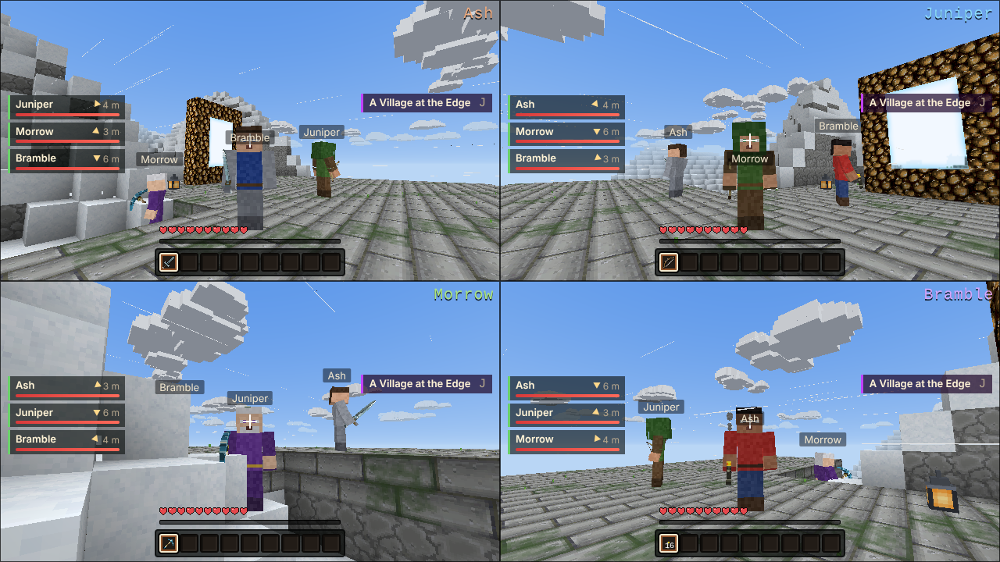

## What is it?

DokuQuest is a block-building sandbox with the heart of an RPG. You wake in a world that goes on as far as you care to walk: forests and deserts, frozen peaks, deep caves and open sea. Dig it, build in it, and survive its nights.

There's more to do than survive. Villages will trade with you, put you to work, and come to count on you. Every skill you use grows with you, from mining and smithing to magic and taming. You can forge, enchant and upgrade your gear, raise animals and ride them, and build machines that do the work for you. Out in the wild are ruins, dungeons and places that are better left alone, unless you're well prepared. And beyond the portals lie other realms.

Play on your own, with up to four people on one screen, or with friends over your home network or a server.

And the world has more going on than it lets on at first. Some things are best found out for yourself.

## Features

- **Play together:** split screen for **2 to 4 players** on one screen (player 1 on keyboard and mouse or a controller, everyone else on a controller), a world opened to your home network, or a dedicated server.
- **Your own look:** any **Minecraft skin** works, so your character can look however you like.
- **Resource packs:** DokuQuest can wear a **Minecraft Java resource pack**: block, item and creature textures, animations, menus and sounds.
- **Portals you can see through:** a lit portal is a window into the realm on the other side, live, and you walk straight through without a loading screen.
- **Maps:** paper maps fill in as you explore, mark villages and the places you're sent, and take your own pins.
- **Distant terrain:** the land goes on far past your render distance, out to 2,048 blocks, drawn simply so it costs little (like the Distant Horizons mod).
- **Living weather:** storms you can see rolling in, fog after the rain, sandstorms and blizzards, waves on the open sea, lightning, rainbows and the northern lights.
- **Dedicated server:** run a world for everyone with a players list, a live world map, an isometric view, chat and console, settings and plugins.
- **Mods and plugins:** add commands and events with the built-in DQ API.
- **A desktop app for Linux and Windows** that keeps itself up to date.

## Screenshots

*In-game pictures are shown with the [GeruDoku](#recommended-resource-pack-gerudoku) resource pack.*

| | |
|:-:|:-:|
| 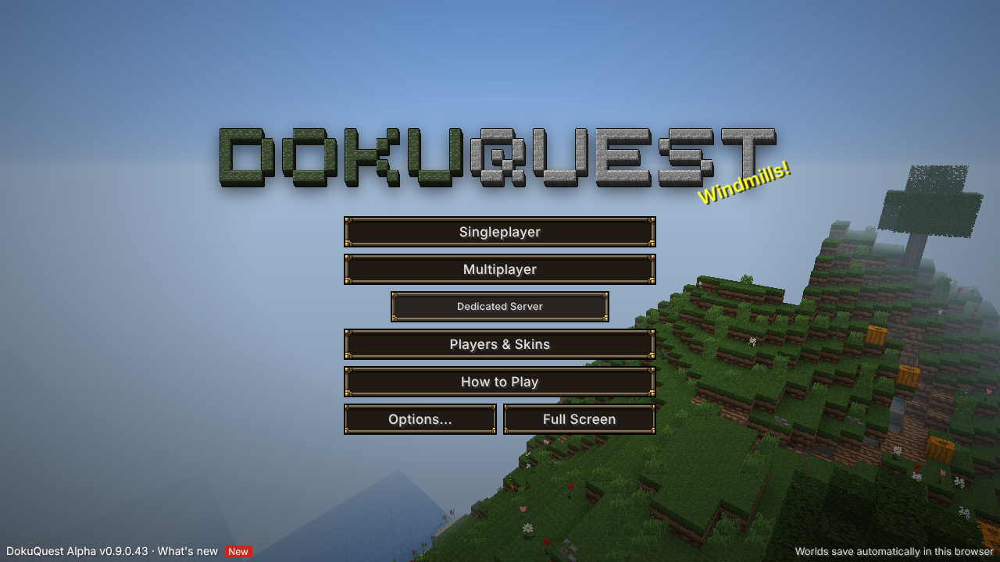 **The main menu** | 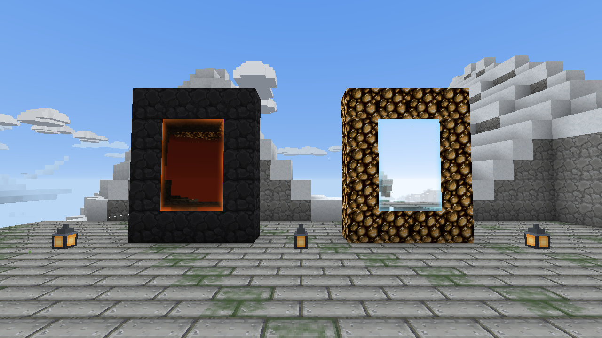 **Portals are windows** into the realm on the other side |
| 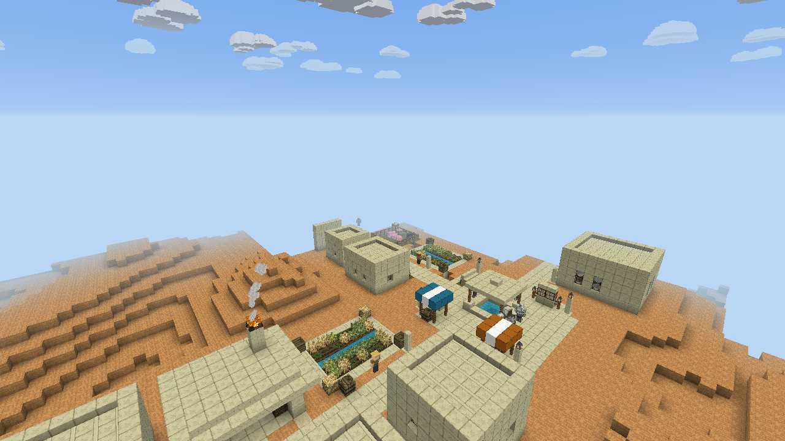 **Villages** to trade with and work for | 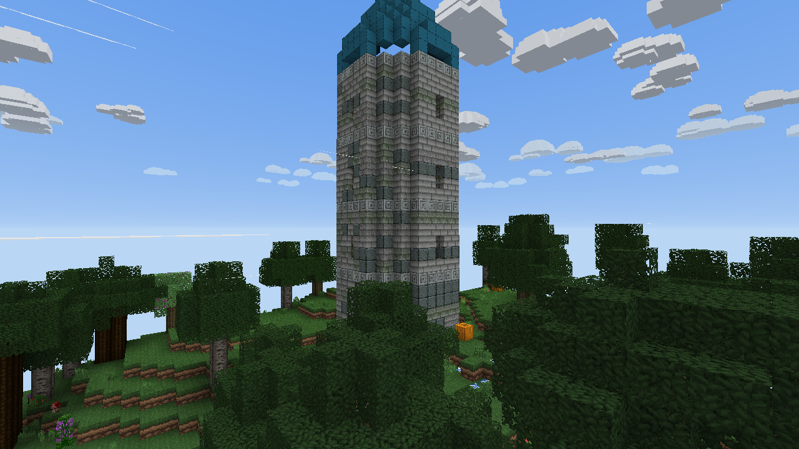 **Places to find**, like the Mage Tower |
| 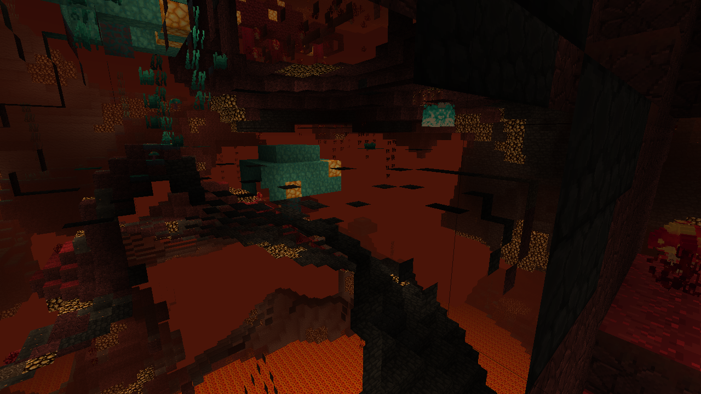 **The Ember Depths** | 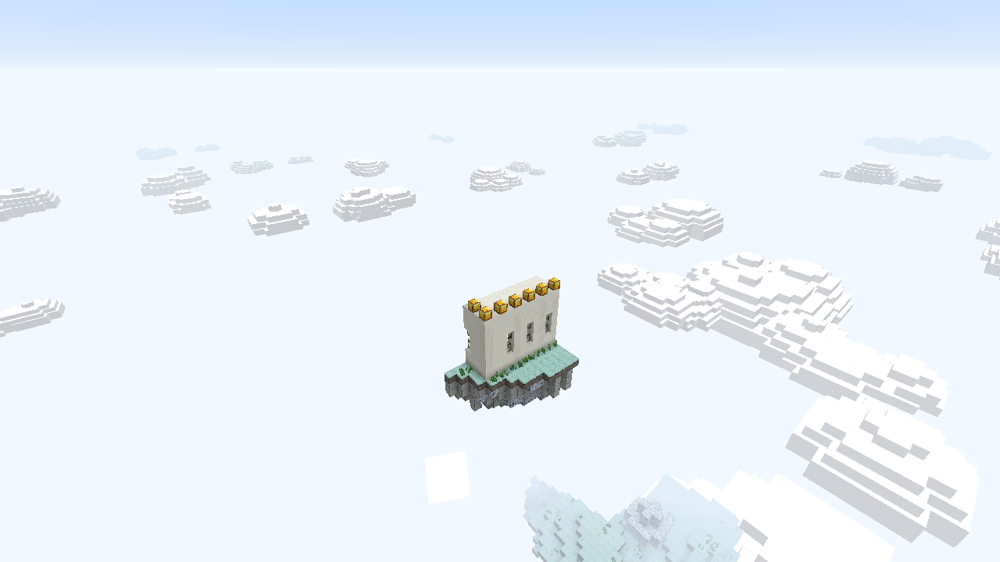 **The Skylands** |
| 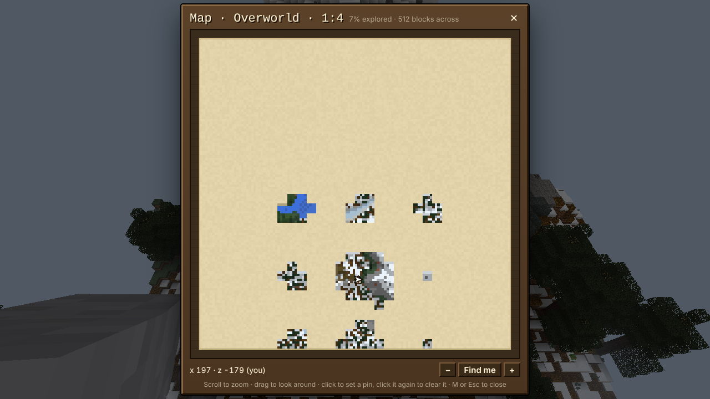 **Maps** that fill in as you explore | 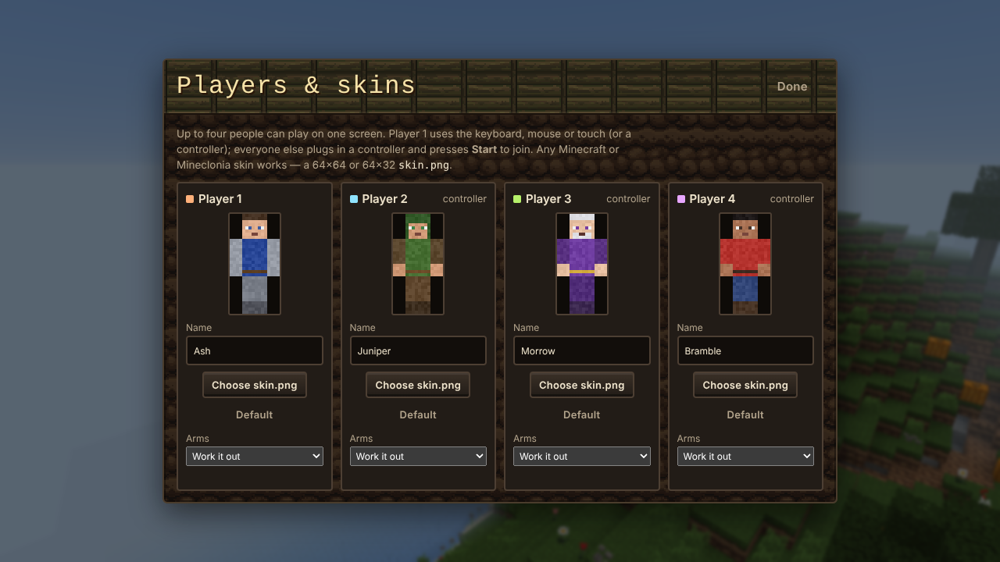 **Players & skins**: up to four players, any Minecraft skin |
| 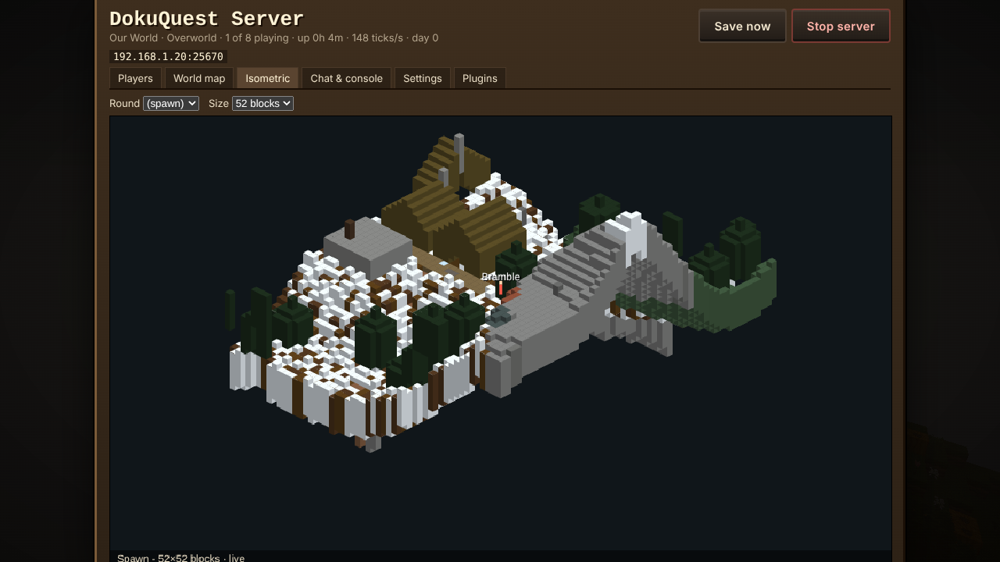 **Dedicated server**: a live isometric view | 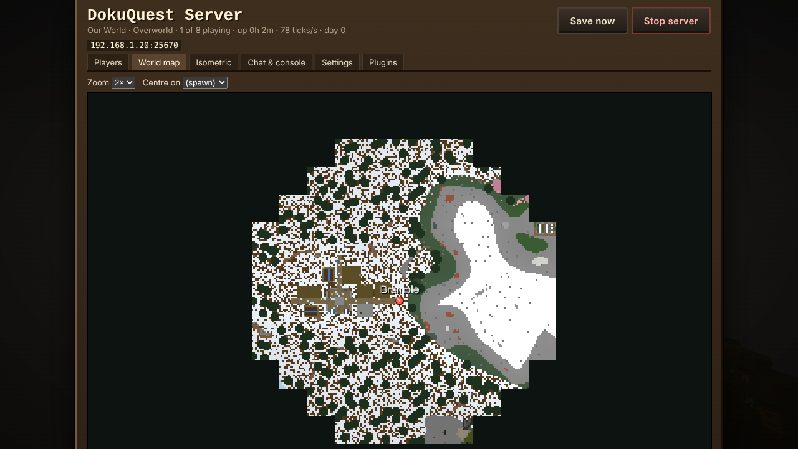 **Dedicated server**: the live world map |
| 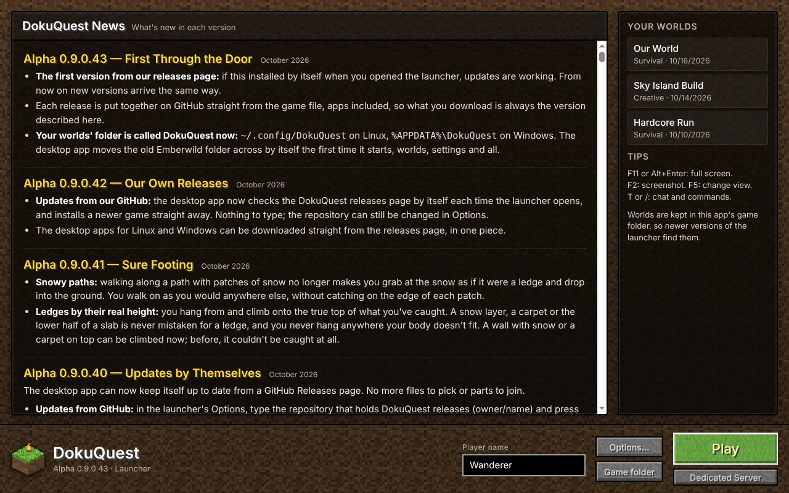 **The desktop launcher**, with the news of every version | 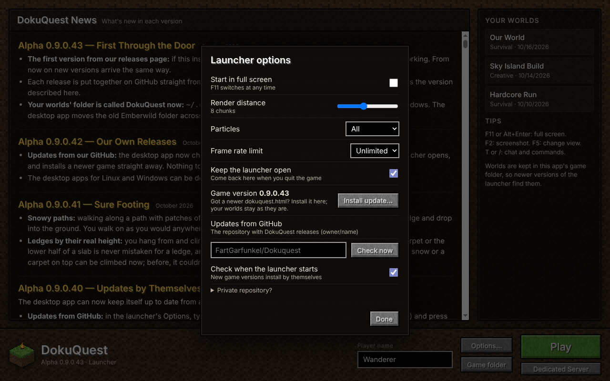 **Launcher options**, with updates from this page |

## Download

Get the newest version from **[Releases](https://github.com/FartGarfunkel/DokuQuest/releases/latest)**:

- **Linux:** `DokuQuest-…-x86_64.AppImage`. Make it executable and run it.
- **Windows:** `DokuQuest-…-windows-x64.zip`. Unzip it anywhere and run `DokuQuest.exe`.
- **Just the game:** `dokuquest.html`. Open it in a browser, or install it in the desktop app with Options → Install update…

## Updates

The desktop app checks for a new version each time the launcher opens and installs it by itself. When the app itself changes, Options offers **Update the app**. Your worlds are never touched: they're kept in the app's own folder (`~/.config/DokuQuest` on Linux, `%APPDATA%\DokuQuest` on Windows).

## Skins

On the title screen, open **Players & Skins** and press **Choose skin.png** for any player. Any Minecraft skin works: the modern 64×64 kind (with its outer layer), the classic 64×32 kind, or a bigger HD one. Slim ("Alex") arms are noticed by themselves, or you can pick the arms yourself. Each of the four players can have their own.

*(The skins in these screenshots were drawn for DokuQuest.)*

## Recommended resource pack: GeruDoku

DokuQuest has its own textures, painted in the spirit of the classic Doku and Gerudoku packs. For the real thing, we recommend **[GeruDoku](https://github.com/sybenx/GeruDoku)**, the classic pack kept up to date by Sybenx and its contributors. It's what the screenshots above are wearing.

1. Download the newest `.zip` from **[GeruDoku's releases](https://github.com/sybenx/GeruDoku/releases/latest)**.
2. In DokuQuest, open **Options** and use **Resource pack → Choose pack (.zip)…**. The game restarts wearing it, and **Built-in** switches back.

GeruDoku isn't part of DokuQuest and isn't included with it. All credit for its art goes to its authors: see the pack's own credits.
